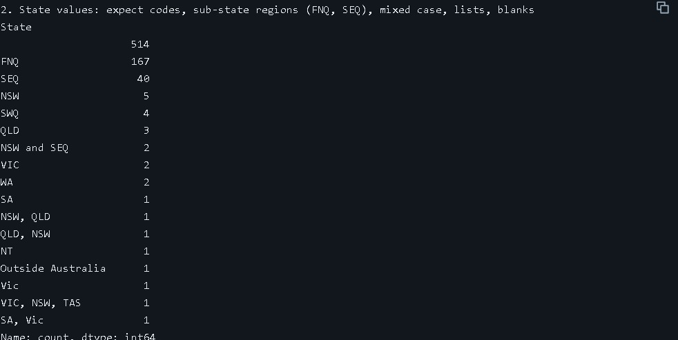
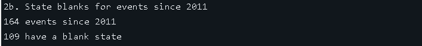
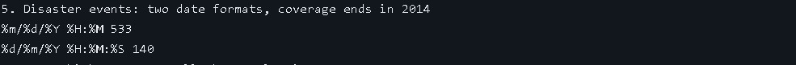
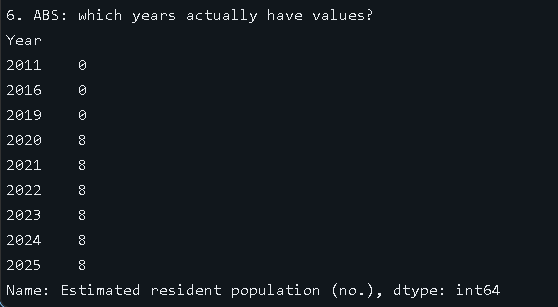
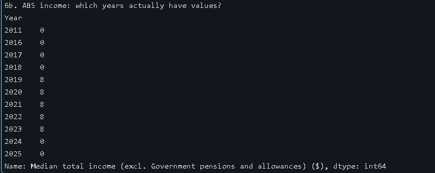
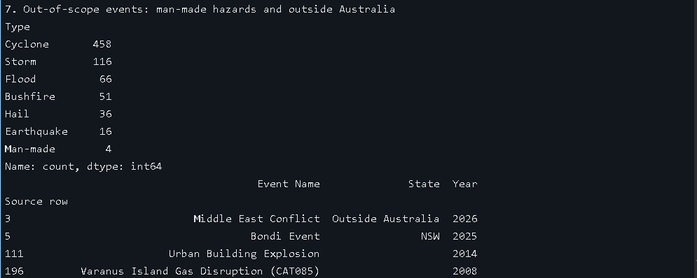

#DATA QUALITY LOG

| # | Issue | Evidence | Impact if ignored | Rule | Result (fill after P8) | Screenshot |
|---|-------|----------|-------------------|------|------------------------|------------|
| DQ1 | Two-digit years parse 100 years late | 27 dates land in 2067–2068 | Events land in the wrong decade; trends in BQ2 are wrong | If the parsed year is after the current year, subtract 100 years. Cross-check against the ICA `Year` column. | rows fixed: ___ ; rows still mismatched: 0 |  |
| DQ2 | State is blank, a sub-state region, or a list | 514 of 747 blank overall; 109 of 164 events since 2011 blank; FNQ 167, SEQ 40, "NSW, QLD" | Loss is attributed to the wrong state or dropped from BQ1, BQ3, BQ5 | Map regions via `xw_state` (FNQ → QLD). For lists, take the first state and set `multi_state_flag`. For blanks, infer from the event name and town using `xw_state_keyword`, and set `state_source = 'inferred'`. Otherwise use Unknown (key -1). | reported ___ / inferred ___ / unknown ___ |   |
| DQ3 | Money and counts stored as text with `$`, commas and `-` | `"$48,957,139"`; 2 dash placeholders and 699 blank claim counts | Sums fail or return null | Strip `$`, commas and spaces, then cast. In ICA claim columns `-` means 0; a blank means unknown (NULL). | rows that failed to cast: 0 |  |
| DQ4 | Undeclared events share one code | 497 of 747 rows are "Undeclared" | Grouping by CAT code merges hundreds of events into one | The event key comes from the source row, never from the CAT code. Set `declaration_status`. | distinct events in the fact = in-scope rows |  |
| DQ5 | Two date formats in disaster events | 533 month-first, 140 day-first (140 fail with a single format) | Matches to ICA are missed | Try month-first, then day-first; keep the first that parses and record which format was used. | unparsed dates: 0 |  |
| DQ6 | ABS has missing years and `-` placeholders | Population only 2020–2025, income only 2019–2023 | Loss per resident is missing for most years | Use the nearest year that has a value (earlier year wins a tie). Store the year used and an `is_imputed` flag. | imputed state-years: ___ |   |
| DQ7 | Out-of-scope events | 4 "Man-made" events (Middle East Conflict, Bondi Event, Urban Building Explosion, Varanus Island Gas Disruption); 1 "Outside Australia" | Non-natural losses distort the hazard analysis | Send to `audit.etl_rejects` with a reason. Never delete. | rejects by reason: ___ |  |